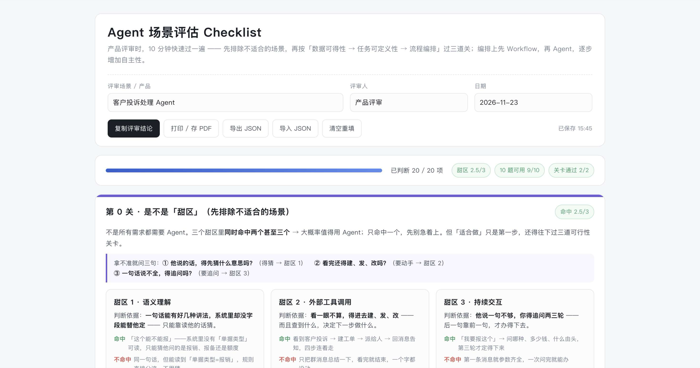

# Agent 场景评估 Checklist

**给写代码的人用的 AI 需求判断清单 —— 要不要加 AI、加在哪一步，先勾一遍再动手。**

我是数据分析出身，平时自己写工具、写脚本。真正卡住我的，往往不是代码，而是产品判断：

- 这东西该怎么设计，用户到底在什么场景下用它？
- 要不要加 AI？加了是不是真的更好？
- 如果要加，AI 该放在哪一步 —— 整条流程交给它，还是只让它做中间一个判断？

没有产品背景，这些事很容易凭感觉拍板。结果无非两种：该用规则的地方硬塞了模型，多出一层不确定性；该让模型理解的地方又写成 if-else，分支越堆越多，最后没人敢改。

后来照着网上公开分享的一套判断方法（先看场景在不在 Agent 的甜区，再看数据够不够、验收标准清不清楚、编排该自主到什么程度），把它做成了这份能逐项勾选的清单。现在每次动手前先过一遍，十分钟，能挡住大部分「为了 AI 而 AI」的需求。

它现在主要帮我三件事：

1. **评审时能说清理由** —— 理由不再是「我觉得该用 AI」，而是「甜区命中 2 个、数据 9/10、编排走 B 档」；
2. **动手前知道 AI 放哪** —— 全 Workflow、Workflow + Agent 单点，还是 Agent 自主编排，选哪档有依据；
3. **判断做不了时知道缺什么** —— 是缺数据、缺验收标准，还是这个需求根本不该做。

> 判断框架来自公开分享的课程和文章，不是我的原创；我做的是把它变成能填、能出结论、能直接贴进纪要的工具。

单文件 HTML，无构建、无后端、无外部依赖，双击就能用；勾选状态存在本机浏览器，不上传任何服务器。

**在线地址：<https://rrd3xerf.qwenwork.host/>**（直接打开，不用装任何东西）



## 判定顺序

```
第 0 关 · 是不是甜区（先排除不适合的场景）
  ├─ 甜区 1 语义理解      命中 1 分 / 部分命中 0.5 分
  ├─ 甜区 2 外部工具调用   命中 ≥2 才往下
  ├─ 甜区 3 持续交互
  └─ 排除项：能否用 if-else 完整描述？ 答「是」→ 直接排除，不用 Agent
        ↓
① 数据可得性（永远排第一位）  10 题 × 存在 / 准确 / 可接入，三格全 ✓ 才算可用
② 任务可定义性              能否一句话说清「做对了」，标准是否客观可核验
③ 流程编排                  A 全 Workflow ／ B Workflow + Agent 单点 ／ C Agent 自主编排
        ↓
评审结论（自动汇总，可一键生成可粘贴文本）
```

结论出口共 7 种：立即启动、先 Workflow + Agent 单点、先建数据、先做调研、用更简单方案、甜区命中不足、结论冲突需复核。

## 怎么用

1. 打开页面（本地双击 `index.html`，或访问线上地址）；
2. 填「评审场景 / 评审人 / 日期」；
3. 从第 0 关往下勾，右侧（移动端为顶部）进度和结论会实时更新；
4. 结论区点 **一键生成结论**，得到一段可直接粘进会议纪要的文本；
5. 需要归档就 **打印 / 存 PDF**，需要换设备就 **导出 JSON**。

## 功能

- 实时判定 + 进度条，七种结论自动匹配下一步动作
- 一键生成结论文本（结论 / 依据 / ⚠ 需确认 / 待补 / 下一步 / 投资倾向），每条都可追溯到你勾的那一格
- 矛盾自动标「⚠ 需确认」，未填自动列「待补」，不编造依据
- 复制评审结论、打印存 PDF、导出 / 导入 JSON
- 自动保存到本机 `localStorage`，刷新不丢；换设备用 JSON 搬运
- 响应式，手机可填；打印样式已适配

## 部署到 GitHub Pages

### 方式一：网页上传（不需要装 git）

1. 在 GitHub 新建仓库，例如 `agent-scenario-checklist`，选 **Public**（私有仓库用 Pages 需要付费）；
2. 进入仓库 → **Add file → Upload files**，把 `index.html`、`README.md`、`docs/` 一起拖进去，提交；
3. **Settings → Pages** → Source 选 `Deploy from a branch`，Branch 选 `main`、目录选 `/ (root)`，保存；
4. 等 1–2 分钟，访问：

```
https://<你的用户名>.github.io/<仓库名>/
```

例如仓库叫 `agent-scenario-checklist`、用户名 `alice`，地址就是
`https://alice.github.io/agent-scenario-checklist/`。

> 如果仓库名直接叫 `<你的用户名>.github.io`，地址就是 `https://<你的用户名>.github.io/`。

### 方式二：命令行

```bash
cd agent-scenario-checklist
git init
git add .
git commit -m "feat: agent scenario checklist"
git branch -M main
git remote add origin https://github.com/<你的用户名>/<仓库名>.git
git push -u origin main
```

推送后按上面第 3 步开启 Pages 即可。

> 首页文件名必须是 `index.html`，所以 HTML 文件不要改名；想换标题改文件里的 `<title>` 和 `<h1>`。

## 本地预览

直接双击 `index.html` 即可。若想用本地服务（避免个别浏览器对 `file://` 的限制）：

```bash
python3 -m http.server 8000
# 打开 http://127.0.0.1:8000
```

## 自定义

所有内容都在 `index.html` 里，改文案不需要动逻辑：

| 想改什么 | 改哪里 |
| --- | --- |
| 标题、副标题 | `<h1>` / `<p class="sub">` |
| 三个甜区的判断依据、例子 | `甜区 1/2/3` 卡片里的 `class="zhint"` 区块 |
| 10 题达标线默认值 | `state.thr`（默认 8），页面上也能直接改 |
| 结论文案与下一步动作 | 脚本里的 `verdict()` |
| 生成结论的格式 | 脚本里的 `buildConclusion()` |

新增题目：在 `compute()` 里加计数、在 HTML 里加一组 `data-bind` 单选项即可；状态会自动进 `localStorage`。

## 数据与隐私

- 所有填写只存在浏览器 `localStorage`，不发请求、不上报；
- 清除浏览器数据或换设备会丢，重要评审请导出 JSON 或存 PDF；
- 页面无埋点、无外链字体、无 CDN 依赖，断网可用。

## 已知边界

- 甜区、任务可定义性带主观判断，清单的作用是**把判断标准化、留下依据**，不是替代评审；
- 10 题测试依赖真实业务问题，编出来的题测不出真实数据缺口；
- 达标线 8/10 是默认经验值，请按团队标准调整；
- 判断方法来自公开分享的课程和文章，清单只是把它工程化；具体判定仍要人拍板。

## License

未附带开源协议；如需对外复用，可自行添加 MIT / Apache-2.0 等协议文件。
